<div align="center">

# Clean PPT Skill

**짧게 요청하고, 자료에 맞는 발표자료를 만드세요.**

Codex와 Claude Code에서 사용하는 한국어 PPT 제작 스킬입니다.<br>
내용 구성, 디자인 선택, 발표자 노트와 출력 검수를 함께 진행합니다.

[디자인 시안](#디자인-시안) · [기본 레이아웃](#기본-레이아웃-12종) · [설치](#설치) · [사용법](#사용법)

</div>

```text
$clean-ppt 이 자료로 5분 발표자료 만들어줘.
```

스타일을 지정하지 않아도 자료와 청중에 맞춰 구성을 선택합니다. 여러 분위기를 비교하고 싶다면 **“서로 다른 스타일로 시안 3개 보여줘”**를 덧붙이세요.

## 디자인 시안

**5가지 스타일의 15장 시안과 12종 기본 레이아웃**을 제공합니다. 색상뿐 아니라 제목의 크기, 열의 비율, 도식과 정보 배치를 달리했습니다. 이미지와 원본을 함께 살펴보고 원하는 방향을 고를 수 있습니다.

예시는 가상 연습 자료입니다. 예제의 수치를 실제 성과로 사용하지 마세요.

| 스타일 | 표지 미리보기 | 잘 맞는 내용 |
| --- | --- | --- |
| **에디토리얼**<br>큰 제목과 비대칭 열 | [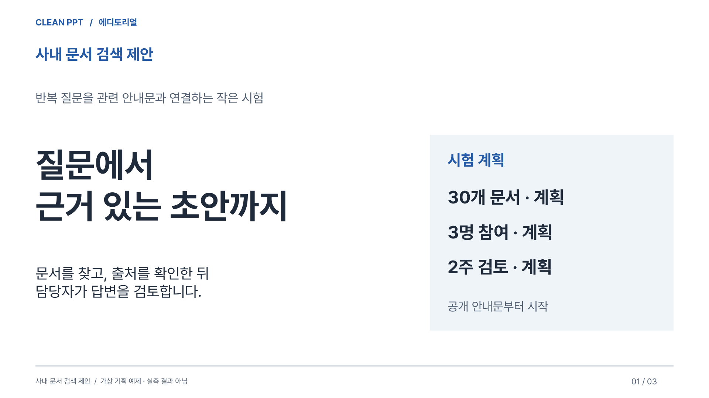](examples/styles/editorial/preview.png) | 기획 의도와 변화 설명 |
| **웜 리포트**<br>따뜻한 바탕과 수직 순서 | [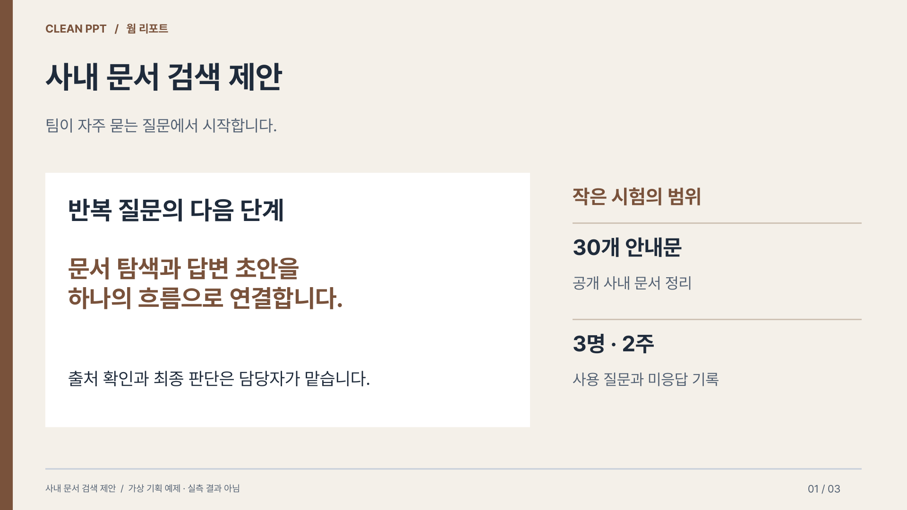](examples/styles/warm/preview.png) | 교육, 팀 회고, 서비스 제안 |
| **테크니컬**<br>왼쪽 탐색 영역과 단계 도식 | [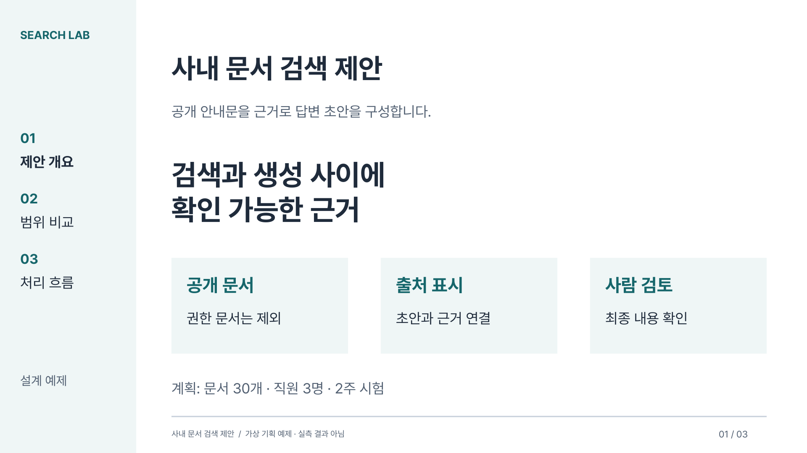](examples/styles/technical/preview.png) | 기술 구조와 처리 경로 |
| **디시전**<br>요약 영역과 비교 매트릭스 | [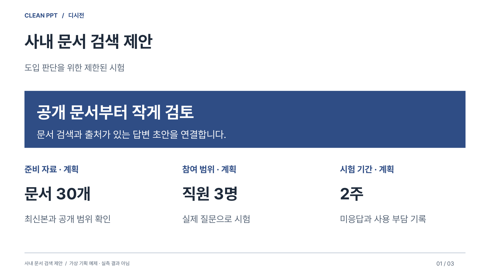](examples/styles/executive/preview.png) | 의사결정과 검토 회의 |
| **스튜디오**<br>큰 번호와 편집형 정보 블록 | [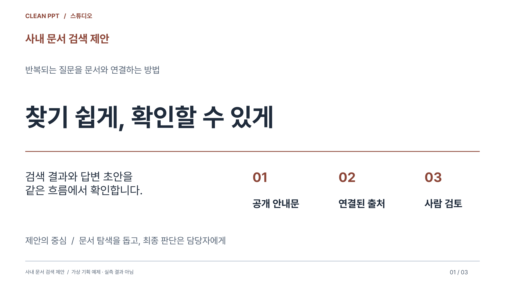](examples/styles/studio/preview.png) | 제품 소개와 포트폴리오 |

### 스타일별 전체 구성

각 스타일은 표지와 본문을 포함한 3장으로 구성했습니다. 아래 항목을 펼치면 전체 미리보기와 편집용 파일을 볼 수 있습니다.

<details>
<summary><strong>에디토리얼</strong> — 큰 제목과 비대칭 열</summary>

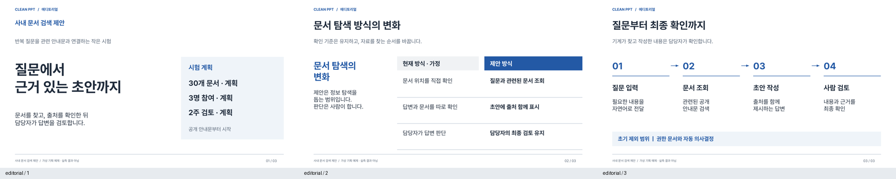

[PPTX 내려받기](examples/styles/editorial/deck.pptx) · [PDF 보기](examples/styles/editorial/deck.pdf) · [장면 JSON](examples/styles/editorial/scene.json) · [발표 메모](examples/styles/editorial/notes.md)

</details>

<details>
<summary><strong>웜 리포트</strong> — 따뜻한 바탕과 수직 순서</summary>

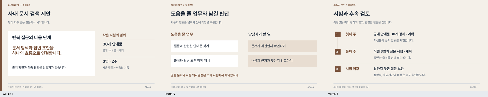

[PPTX 내려받기](examples/styles/warm/deck.pptx) · [PDF 보기](examples/styles/warm/deck.pdf) · [장면 JSON](examples/styles/warm/scene.json) · [발표 메모](examples/styles/warm/notes.md)

</details>

<details>
<summary><strong>테크니컬</strong> — 왼쪽 탐색 영역과 단계 도식</summary>

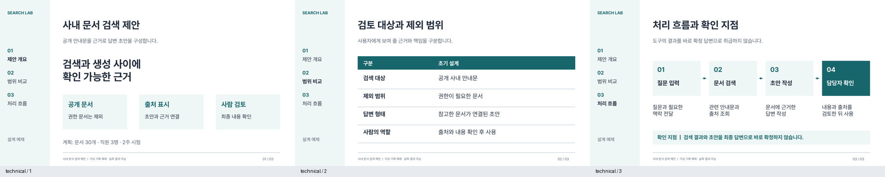

[PPTX 내려받기](examples/styles/technical/deck.pptx) · [PDF 보기](examples/styles/technical/deck.pdf) · [장면 JSON](examples/styles/technical/scene.json) · [발표 메모](examples/styles/technical/notes.md)

</details>

<details>
<summary><strong>디시전</strong> — 요약 영역과 비교 매트릭스</summary>

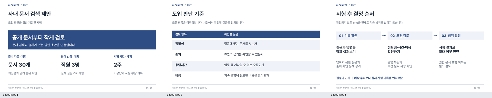

[PPTX 내려받기](examples/styles/executive/deck.pptx) · [PDF 보기](examples/styles/executive/deck.pdf) · [장면 JSON](examples/styles/executive/scene.json) · [발표 메모](examples/styles/executive/notes.md)

</details>

<details>
<summary><strong>스튜디오</strong> — 큰 번호와 편집형 정보 블록</summary>

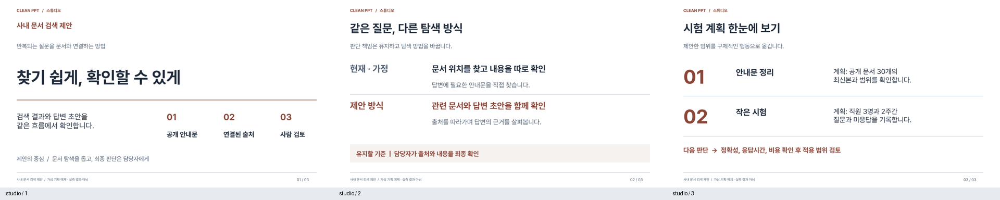

[PPTX 내려받기](examples/styles/studio/deck.pptx) · [PDF 보기](examples/styles/studio/deck.pdf) · [장면 JSON](examples/styles/studio/scene.json) · [발표 메모](examples/styles/studio/notes.md)

</details>

## 기본 레이아웃 12종

비교, 과정, 수치, 일정 등 설명할 내용에 맞춰 골라 쓰는 구성입니다. 미리보기를 누르면 해당 장의 JSON 원본을 열 수 있습니다.

[전체 12장 PPTX](examples/layout-gallery/deck.pptx) · [전체 PDF](examples/layout-gallery/deck.pdf) · [유형별 사용 안내](templates/README.md)

<details>
<summary><strong>12종 레이아웃 펼쳐 보기</strong></summary>

| 레이아웃 | 레이아웃 | 레이아웃 |
| --- | --- | --- |
| **01 표지**<br>[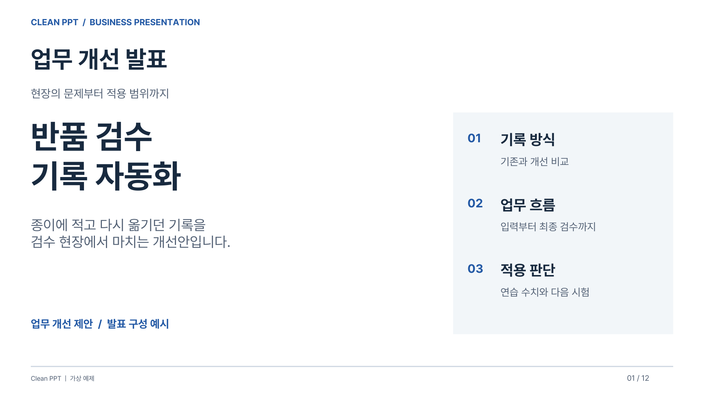](templates/v9-cover.json) | **02 개선 전후**<br>[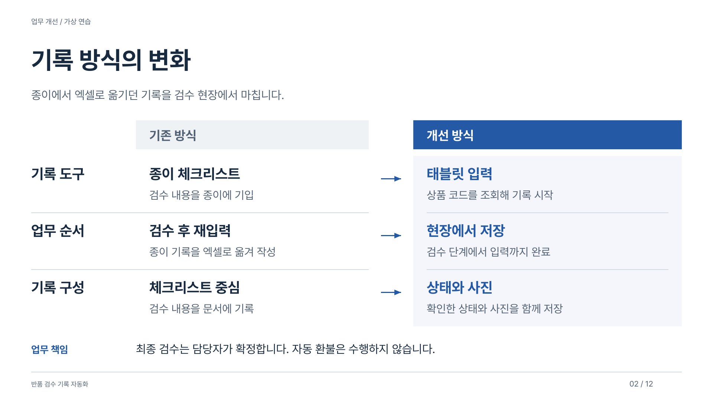](templates/v9-comparison.json) | **03 업무 흐름**<br>[](templates/v9-process.json) |
| **04 수치 비교**<br>[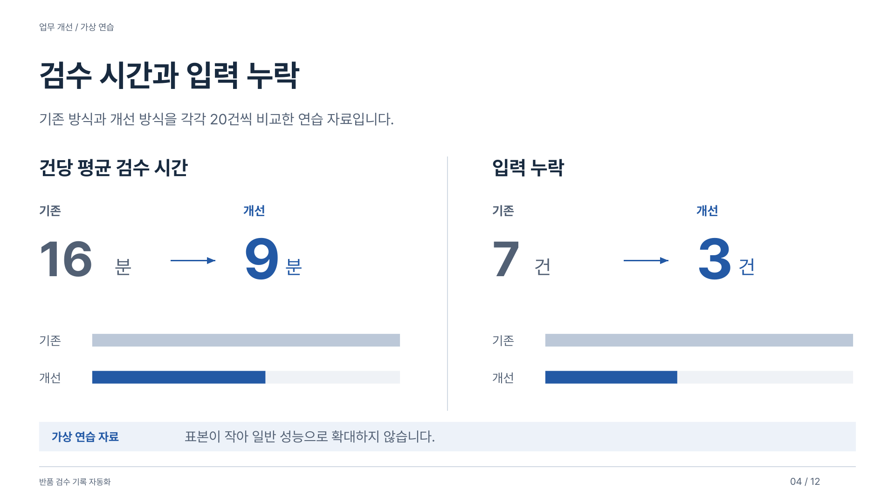](templates/v9-results.json) | **05 적용 범위**<br>[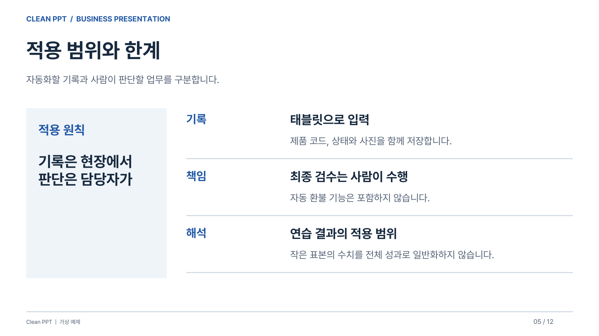](templates/v9-scope.json) | **06 다음 단계**<br>[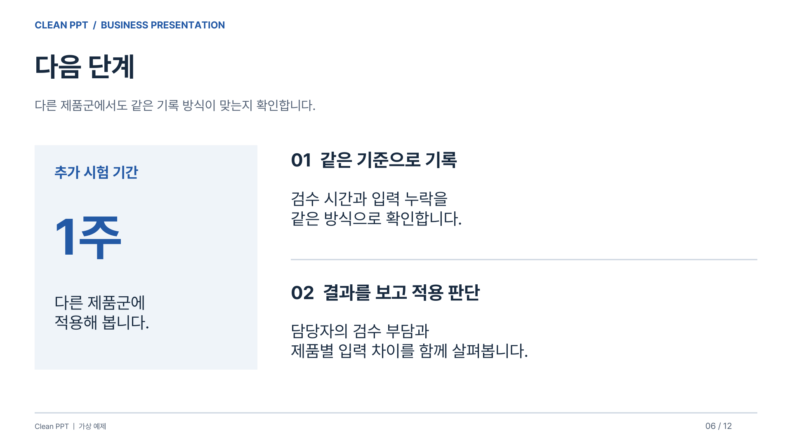](templates/v9-next-step.json) |
| **07 시험 일정**<br>[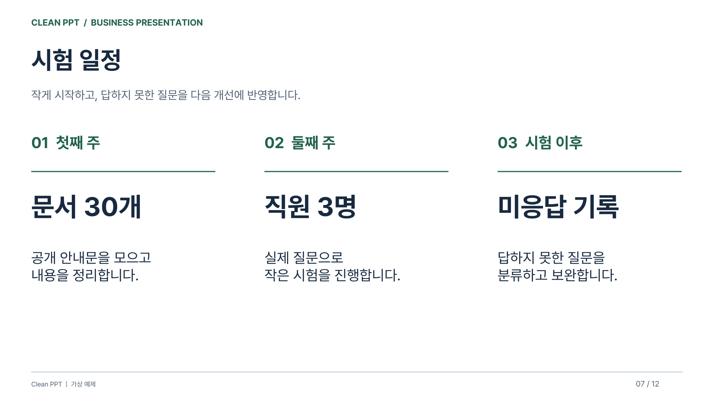](templates/v9-timeline.json) | **08 검토 항목**<br>[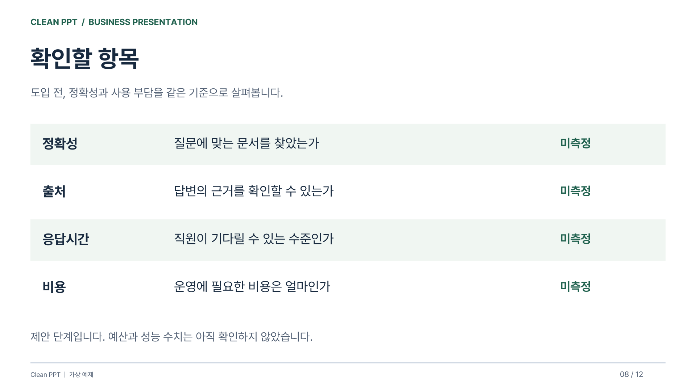](templates/v9-checklist.json) | **09 도입 판단**<br>[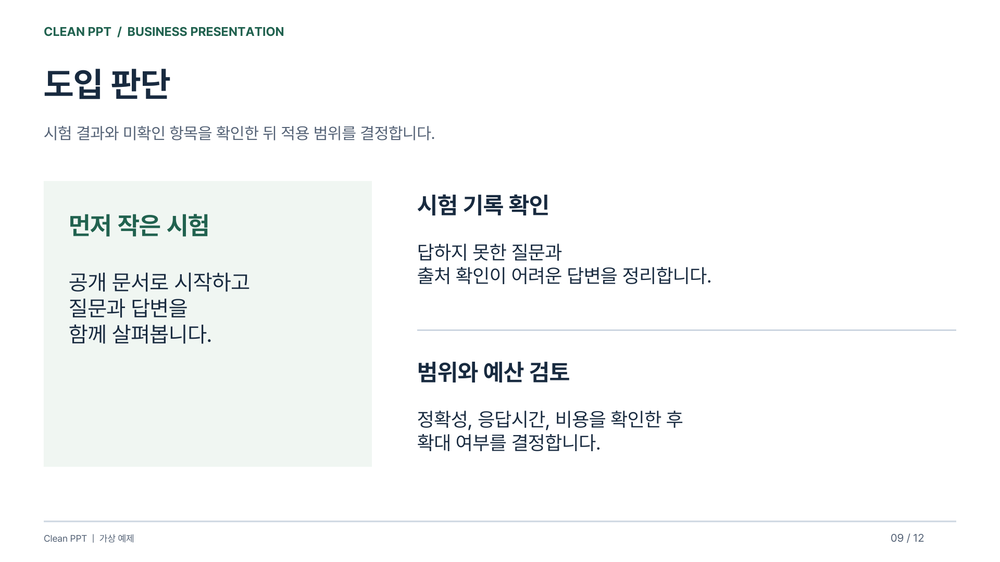](templates/v9-decision.json) |
| **10 서비스 구조**<br>[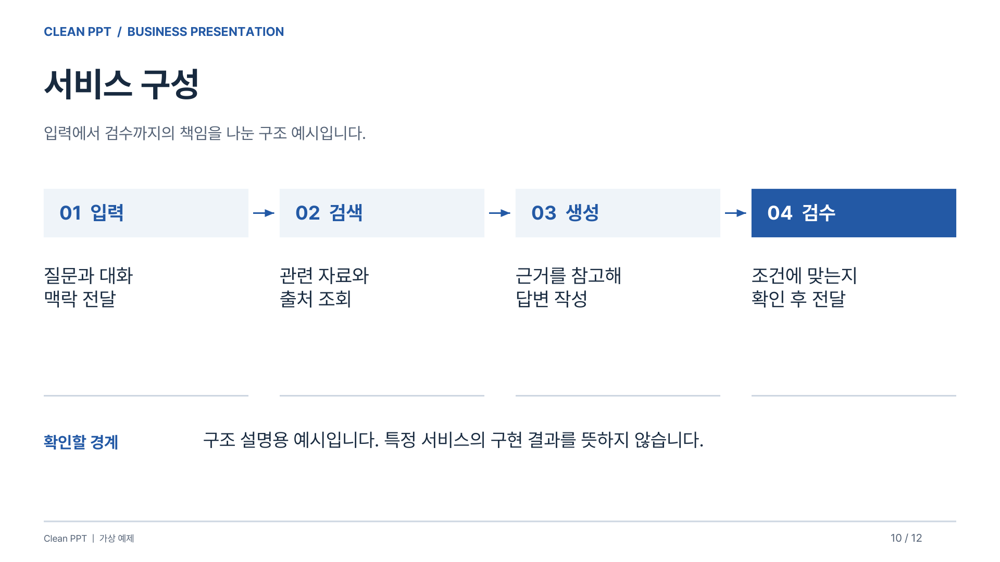](templates/v9-architecture.json) | **11 조건 분기**<br>[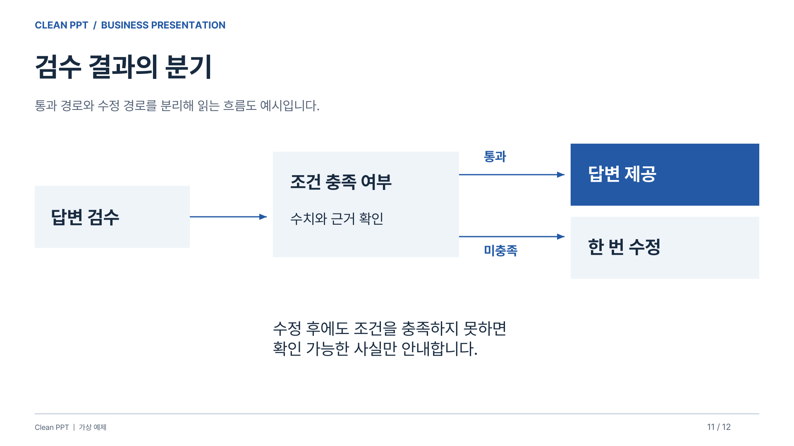](templates/v9-branch.json) | **12 코드 설명**<br>[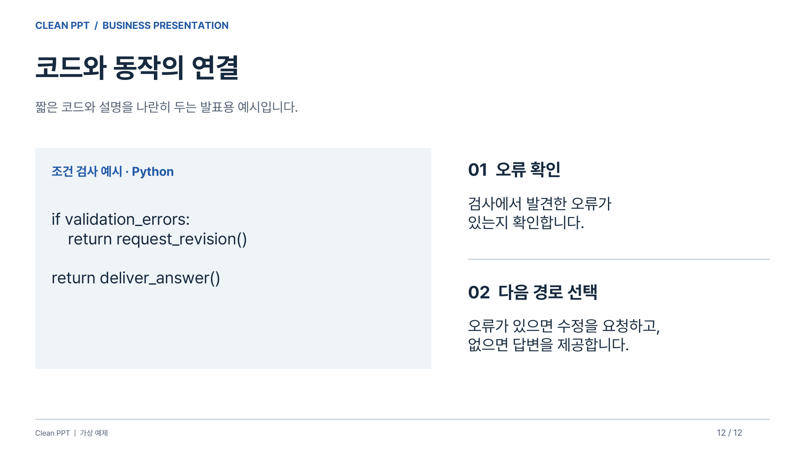](templates/v9-code.json) |

</details>

<details>
<summary><strong>완성된 발표 예제</strong> — 업무 개선 6장 / 브랜드 제안서 5장</summary>

### 업무 개선 발표


[PPTX](examples/business-blue/deck.pptx) · [PDF](examples/business-blue/deck.pdf) · [입력 자료](examples/business-blue/brief.md) · [장면 JSON](examples/business-blue/scene.json) · [발표 메모](examples/business-blue/notes.md)

### 브랜드 제안서


[PPTX](examples/brand-green/deck.pptx) · [PDF](examples/brand-green/deck.pdf) · [입력 자료](examples/brand-green/brief.md) · [장면 JSON](examples/brand-green/scene.json)

</details>

> [!NOTE]
> 예시 PDF와 이미지는 같은 장면 원본을 별도로 렌더링한 결과입니다. PowerPoint에서 직접 내보낸 PDF는 아닙니다. 실제 앱의 줄바꿈과 글꼴 대체는 사용하는 환경에서 확인해야 합니다.

## 짧은 요청으로 만든 예제

스타일을 지정하지 않은 팀 회고 요청에서 웜 리포트를 선택해 3장을 제작했습니다. 공유 양식 제안이라는 입력을 유지하고, 검색 서비스 예제의 숫자와 기능을 복사하지 않았습니다.

<details>
<summary>입력부터 결과까지 보기</summary>

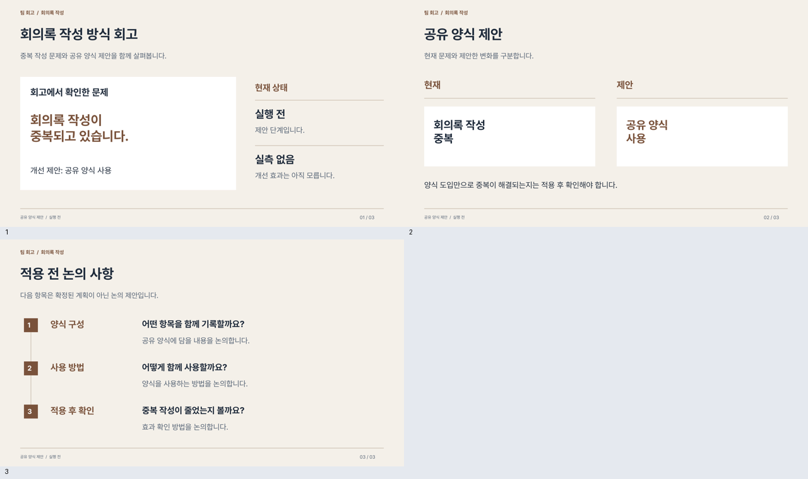

[짧은 요청과 입력 자료](examples/short-prompt/brief.md) · [PPTX](examples/short-prompt/deck.pptx) · [PDF](examples/short-prompt/deck.pdf) · [원본](examples/short-prompt/scene.json) · [검토 기록](evals/design-review.md)

</details>

## 설치

V9 원본 파일이나 제작자의 대화 기록은 필요하지 않습니다. 스킬 지침, 디자인 기준, 예제와 제작 도구가 이 저장소에 들어 있습니다.

**Codex**

```bash
git clone https://github.com/kgyujin/clean-ppt-skill.git "$HOME/.codex/skills/clean-ppt"
```

**Claude Code**

```bash
git clone https://github.com/kgyujin/clean-ppt-skill.git "$HOME/.claude/skills/clean-ppt"
```

기존 `clean-ppt` 폴더가 있다면 설치 위치를 먼저 확인하세요. 설치 후 새 대화에서 호출합니다.

## 사용법

Codex는 `$clean-ppt`, Claude Code는 `/clean-ppt`로 호출합니다. 자료를 첨부하고 발표 시간이나 용도를 짧게 알려주세요.

| 원하는 작업 | 요청 예시 |
| --- | --- |
| 자료로 새 발표 만들기 | `$clean-ppt 이 자료로 5분 발표자료 만들어줘.` |
| 분위기를 먼저 비교하기 | `$clean-ppt 이 기획서로 서로 다른 스타일의 시안 3개 보여줘.` |
| 특정 스타일 사용하기 | `/clean-ppt 웜 리포트 스타일로 팀 회고 발표 만들어줘.` |
| 기존 PPT 다듬기 | `/clean-ppt 내용과 수치는 유지하고 글자 크기, 정렬과 도식을 다듬어줘.` |

자료에 없는 수치나 결과를 만들지 않고, 긴 내용은 글씨를 줄이기 전에 나누거나 재배치합니다. 편집용 PPTX, PDF와 미리보기의 제작 가능 여부는 실행 환경에 따라 확인합니다.

[발표 요청 양식](docs/brief-template.md) · [스타일 선택 기준](references/style-selection.md)

## 디자인과 검수 기준

원래 V9 발표자료의 서체, 정렬과 정보 구분 기준을 바탕으로 스타일을 확장했습니다. Pretendard를 기본으로 사용하며 그라데이션, 검은 표지, 불필요한 장식 카드를 기본값에 넣지 않습니다.

| 항목 | 기준 |
| --- | --- |
| 화면과 여백 | 16:9, 1280 × 720 기준, 일정한 정렬선 유지 |
| 서체와 크기 | Pretendard Regular / Bold, 기본 제목 33pt, 본문 약 18~22pt |
| 색상 | 스타일에 맞는 제한된 색상, 브랜드 색상이 있으면 우선 적용 |
| 도식과 이미지 | 편집 가능한 도형·표·차트, 방향이 분명한 화살표, 이미지 비율 유지 |
| 내용 | 원문 수치와 조건 보존, 짧은 제목과 발표자 노트 |
| 검수 | 발표자·청중·디자이너·내용 검토자의 관점으로 읽기와 표현 점검 |

미리캔버스 공개 레퍼런스의 배치와 정보 구분 방식을 참고합니다. 원본 템플릿의 이미지나 디자인 요소를 가져와 배포하지 않습니다. 취향이 다른 모든 사람의 만족을 보장하기보다, 읽기 어려운 부분과 내용 전달의 문제를 찾아 수정하는 데 검수를 사용합니다.

[디자인 기준](references/design-system.md) · [레퍼런스 참고 방식](references/reference-research.md) · [관점별 검수](references/persona-review.md) · [제작 및 출력 검수](references/production-and-qa.md)

## 제작 환경

스킬은 에이전트가 읽는 지침입니다. 설치만으로 PowerPoint나 제작 라이브러리가 함께 설치되지는 않습니다.

| 용도 | 필요 항목 |
| --- | --- |
| PPTX 보조 제작기 | Node.js, `pptxgenjs`, Python 3 |
| PDF·미리보기 | Python의 `reportlab`, `Pillow`, `PyMuPDF` |
| 한글 서체 | Pretendard Regular / Bold, PDF 제작 시 글꼴 파일 경로 |
| 실제 PPTX 렌더 | 사용 가능한 PowerPoint, Keynote 또는 LibreOffice |

[제작 도구 실행과 재현 방법](docs/tooling.md)을 참고하세요. PPTX는 서체를 지정하지만 폰트를 내장하지는 않습니다. 글꼴은 [Pretendard 공식 배포처](https://github.com/orioncactus/pretendard)에서 준비할 수 있습니다.
