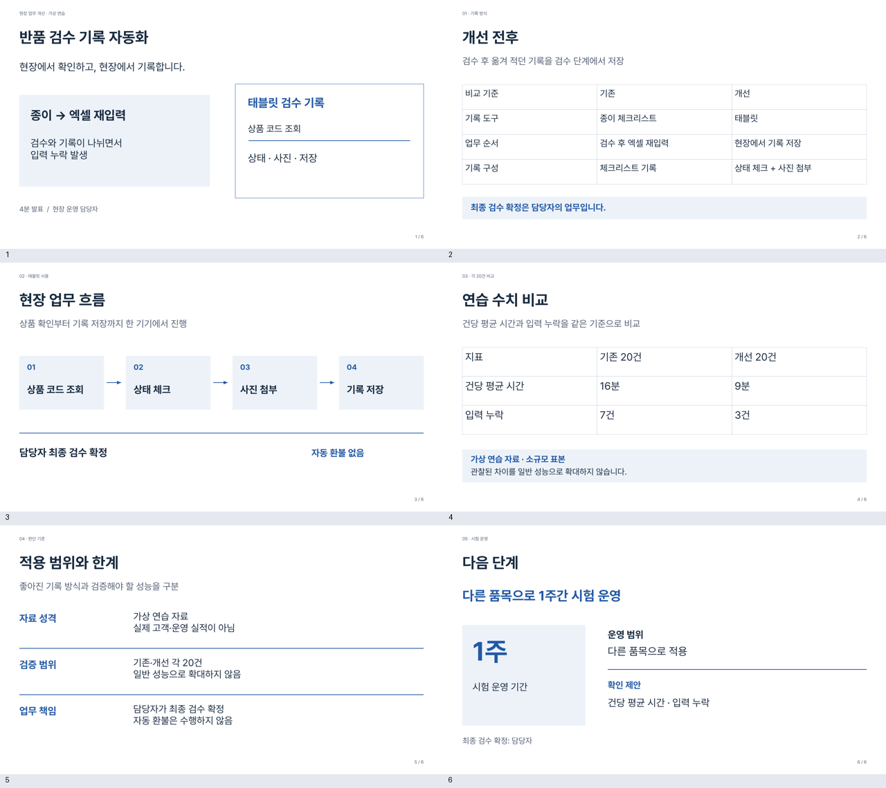
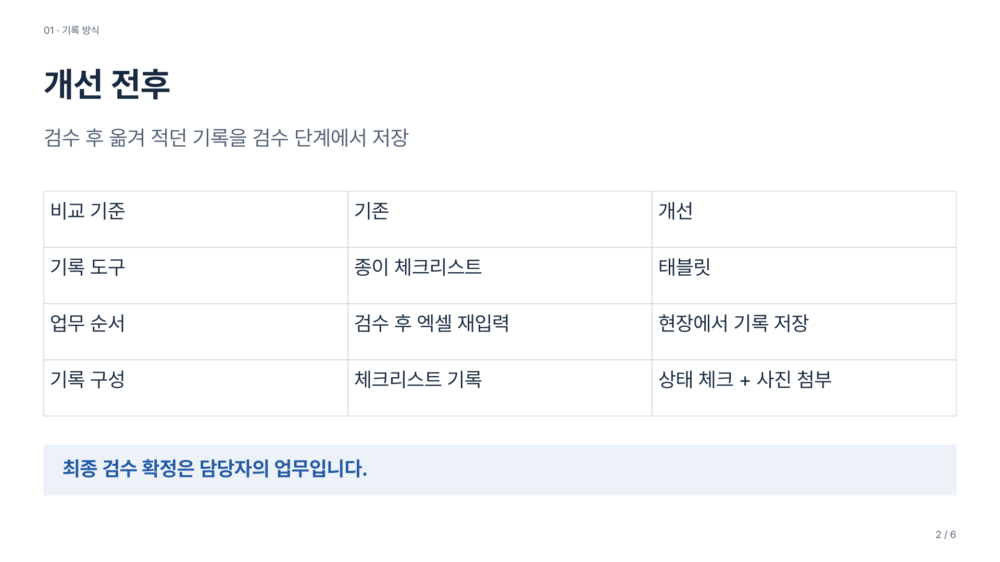
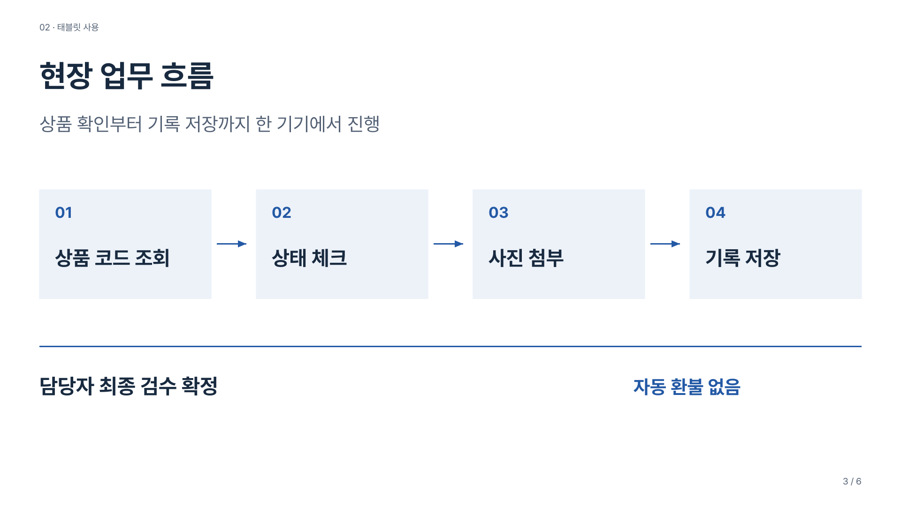
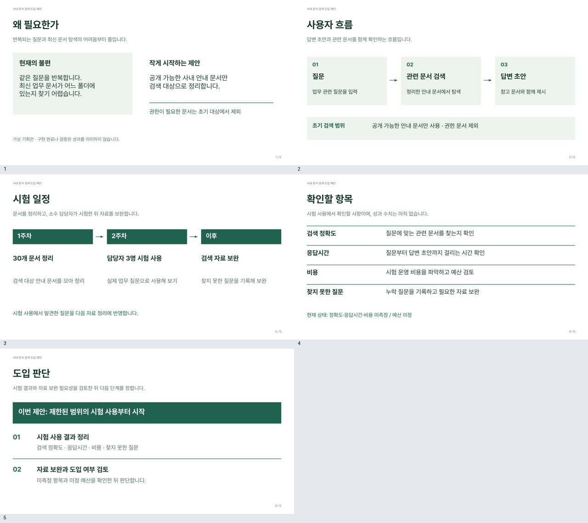

<div align="center">

# Clean PPT Skill

**자료를 주면, 내용 구성부터 디자인 검수까지.**

한국어 발표자료를 위한 Codex · Claude Code 스킬입니다.<br>
밝은 바탕, Pretendard, 절제된 색상과 일정한 정렬을 기본으로 사용합니다.

[결과 예시](#결과-예시) · [설치](#설치) · [사용법](#사용법) · [디자인 기준](#디자인-기준)

</div>



## 어떤 스킬인가요?

발표 내용과 참고자료를 읽고, 각 장의 핵심과 배치를 함께 설계합니다. 제작 후에는 발표자, 청중, 디자이너의 관점에서 글자 크기와 정렬, 도식과 이미지까지 확인합니다.

원래 V9 발표자료에서 사용한 디자인 기준을 문서와 예제로 담았습니다. 그 파일이나 제작자의 대화 기록 없이도 같은 기준으로 시작할 수 있습니다. 모든 자료를 같은 틀에 넣는 대신, 비교에는 비교표를, 과정에는 흐름도를 사용합니다.

| 구성 | 기본 동작 |
| --- | --- |
| 내용 | 원문 수치와 조건 유지, 짧은 제목과 발표자 노트 구성 |
| 디자인 | Pretendard, 일정한 여백과 글자 크기, 절제된 파랑 |
| 레퍼런스 | 미리캔버스 공개 자료의 배치 원리 참고, 템플릿 원본 복제 제외 |
| 시각자료 | 편집 가능한 도형·표·차트, 비율을 유지한 화면 캡처 |
| 검수 | 전 페이지 미리보기, 줄바꿈·정렬·화살표·화질 확인 후 수정 |
| 산출물 | 편집용 PPTX, PDF, 전체 미리보기와 제작 원본 |

## 결과 예시

아래 파일은 이 스킬을 적용해 만든 예시입니다. 가상 연습 자료를 사용했으며 실제 운영 실적이 아닙니다. 이미지를 누르면 크게 볼 수 있습니다.

### 기본형: 업무 개선 발표

차분한 파랑을 사용한 6장 구성입니다. 개선 전후, 업무 흐름, 수치 비교, 적용 범위와 다음 단계를 보여줍니다.

| 개선 전후 | 업무 흐름 |
| --- | --- |
|  |  |

[PPTX 내려받기](examples/business-blue/deck.pptx) · [PDF 보기](examples/business-blue/deck.pdf) · [입력 자료](examples/business-blue/brief.md) · [수정 가능한 장면 JSON](examples/business-blue/scene.json) · [발표 메모](examples/business-blue/notes.md)

### 응용형: 브랜드 색상 적용

동일한 서체와 정렬 체계를 유지하면서 짙은 초록을 적용한 5장 제안서입니다.



[PPTX 내려받기](examples/brand-green/deck.pptx) · [PDF 보기](examples/brand-green/deck.pdf) · [입력 자료](examples/brand-green/brief.md) · [수정 가능한 장면 JSON](examples/brand-green/scene.json)

> [!NOTE]
> 예시 PDF와 이미지는 같은 장면 원본을 별도로 렌더링한 결과입니다. PowerPoint에서 직접 내보낸 PDF는 아닙니다. PPTX의 구조 검사는 통과했으며, 실제 앱의 줄바꿈과 글꼴 대체는 사용하는 환경에서 확인해야 합니다.

## 설치

이 저장소를 공유받아도 V9 원본 파일은 필요하지 않습니다. 스킬 지침, 디자인 수치, 예제 원본과 제작 도구가 모두 들어 있습니다.

### Codex

```bash
git clone https://github.com/kgyujin/clean-ppt-skill.git "$HOME/.codex/skills/clean-ppt"
```

### Claude Code

```bash
git clone https://github.com/kgyujin/clean-ppt-skill.git "$HOME/.claude/skills/clean-ppt"
```

기존 `clean-ppt` 폴더가 있다면 덮어쓰지 말고 기존 설치 위치를 먼저 확인하세요. 설치 후 새 대화에서 호출합니다.

## 사용법

Codex에서는 `$clean-ppt`, Claude Code에서는 `/clean-ppt`를 붙입니다.

```text
$clean-ppt 첨부 자료로 5분 발표용 PPT를 만들어줘.
기본 파란 비즈니스 스타일을 사용하고, 비교표와 흐름도를 넣어줘.
편집 가능한 PPTX, PDF, 전체 미리보기와 발표자 노트까지 만들어줘.
```

기존 PPT를 다듬을 수도 있습니다.

```text
/clean-ppt 이 PPT의 내용과 수치는 유지하고 디자인을 정돈해줘.
Pretendard로 통일하고 제목 위치, 본문 크기, 여백을 맞춰줘.
흐릿한 캡처와 읽기 어려운 도식을 확인해서 고쳐줘.
```

구체적인 요청이 필요하면 [발표 요청 양식](docs/brief-template.md)을 복사해 사용합니다. 발표 시간, 청중, 핵심 내용과 원하는 색상만 적어도 됩니다.

## 디자인 기준

기본형은 흰 바탕에 파랑 `#2459A6`을 사용합니다. 그라데이션과 검은 표지, 반복되는 장식 카드는 기본값에 넣지 않습니다.

| 항목 | 기본값 |
| --- | --- |
| 화면 | 16:9, 1280 × 720 기준 |
| 서체 | Pretendard Regular / Bold |
| 제목 | 33pt, 왼쪽 정렬 |
| 본문 | 약 18~22pt |
| 좌우 여백 | 56px, 약 0.58인치 |
| 시각자료 | 내용에 맞는 비교표·흐름도·차트·캡처 |

이는 시작 기준입니다. 내용이 길다고 장마다 글씨를 줄이지 않고, 정보 묶음을 재배치하거나 장을 나눕니다. 브랜드 색상이 지정되면 해당 색상을 우선합니다.

[세부 디자인 기준](references/design-system.md) · [레퍼런스 분석 방법](references/reference-research.md) · [제작 및 검수 절차](references/production-and-qa.md)

## 제작 환경

스킬은 코딩 에이전트가 읽는 지침입니다. 설치만으로 PowerPoint나 제작 라이브러리가 함께 설치되지는 않습니다.

| 용도 | 필요 항목 |
| --- | --- |
| PPTX 보조 제작기 | Node.js, `pptxgenjs`, Python 3 |
| PDF·미리보기 | Python의 `reportlab`, `Pillow`, `PyMuPDF` |
| 한글 서체 | Pretendard Regular / Bold 설치, PDF 제작 시 글꼴 파일 경로 |
| 실제 PPTX 렌더 | 사용 가능한 PowerPoint, Keynote 또는 LibreOffice |

[제작 도구 실행과 재현 방법](docs/tooling.md)을 제공합니다. PPTX는 서체를 지정하지만 폰트를 내장하지는 않습니다. 글꼴은 [Pretendard 공식 배포처](https://github.com/orioncactus/pretendard)에서 준비하세요.

> [!TIP]
> 기본 스타일을 그대로 시작하려면 “업무 개선 발표 예시의 디자인 기준으로 만들어줘”라고 요청하세요. 완성도는 내용과 분량에 따라 달라지므로, 예시 모양의 자동 복제보다 실제 출력 검수를 우선합니다.
